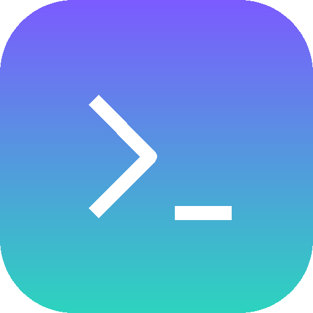

# Asuka Harness Desktop

Asuka Harness 的桌面外壳：一个可换肤的 Electron 窗口，当前加载官方 `dsh web` 的完整 Web UI，后续可无缝切到 `@asuka/core` 的 HTTP 服务。

<p align="center">
  
</p>

## 现在能做什么

- **任意壁纸**：内置 4 套；页面右下角悬浮按钮支持「点击选图 / 拖图 / 右键管理 / 拖动换位置」
- **壁纸层与应用背景分离**：暗化、模糊、平铺/裁切，可让壁纸透出应用外层
- **托盘常驻**：显示/隐藏、换肤、重启后端、打开日志
- **全局快捷键**：默认 `Ctrl/Cmd + Shift + Space`
- **崩溃自愈**：后端异常退出按指数退避重启，日志落盘
- **安全边界**：页面无 Node 集成、preload 不向页面暴露 API、上下文隔离

## 运行

需要 Node.js ≥ 22。默认后端是官方 CLI：

```bash
npm i -g @deepseek-ai/dsh

# 在仓库根目录
npm install
npm start            # 等同于 npm run start -w @asuka/desktop
npm test             # 桌面壳 + core 的测试
```

只跑桌面壳的测试：

```bash
npm test -w @asuka/desktop
```

## 后端模式

| 模式 | 配置 | 行为 |
|---|---|---|
| 启动 `dsh web`（默认） | `dshCommand` / `DSH_BIN` | 自动挑端口、抓 token URL、退出时清理进程 |
| 连接已有实例 | `attachUrl` | 不启动子进程；「重启后端」变成刷新页面 |
| 连接 `@asuka/core`（规划中） | `attachUrl` 指向 Core 的 HTTP 根 | Core 提供 `/v1/*` 与事件流后即可切换 |

配置文件位置：

- Linux：`~/.config/asuka-harness/settings.json`
- Windows：`%APPDATA%\asuka-harness\settings.json`
- macOS：`~/Library/Application Support/asuka-harness/settings.json`

## 打包

```bash
npm run dist:linux   # 在仓库根目录；产出 apps/desktop/dist/*.deb 与 *.AppImage
npm run dist:win
npm run dist:mac
```

详细步骤、依赖覆盖、Docker/CI 构建与排错见 [docs/PACKAGING.md](docs/PACKAGING.md)。

## 安全说明

- 页面运行在 `contextIsolation: true`、`nodeIntegration: false`、`sandbox: true` 下
- 主窗口的 preload **不向页面暴露任何 API**：只给注入的悬浮按钮绑定行为，再通过 IPC 请求主进程
- 只允许同源导航，其余链接交给系统浏览器
- 一次性 launch token 只存在于窗口 URL 中，不写入磁盘

## 与 Core 的关系

桌面壳只负责窗口、皮肤、托盘和后端进程；会话、工具、人设都在 `@asuka/core`。
人设编辑等能力将由 Core 的 `/v1/personas` 提供，桌面壳只做展示，避免逻辑分叉。

完整架构见仓库根目录 [README](../../README.md) 与 [docs/ARCHITECTURE.md](../../docs/ARCHITECTURE.md)。
